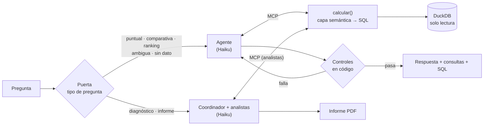

# Analista de datos · Almacenes del Sur

Un agente que responde preguntas de negocio sobre una cadena de supermercados y arma informes ejecutivos en PDF. **Cada número sale de una consulta registrada, que se puede mostrar y volver a correr.**

Proyecto final del Taligen Spring Camp. Usa Claude Haiku 5.5 (`claude-haiku-5-5`), un servidor MCP propio y DuckDB.

> **El modelo elige qué medir; el código mide.** Haiku interpreta la pregunta y elige la medida, los filtros y el período. La fórmula, el SQL, las variaciones, los gráficos y los controles son código. Un número no puede salir de una cuenta del modelo.

## Resultados

| Qué | Resultado |
|---|---|
| Evaluador: preguntas y conversaciones del enunciado | **21 de 21** (17 de trabajo y 4 de reserva) |
| Consistencia: cada caso 10 veces | **170 de 170** de trabajo; reserva 39 de 40 |
| Informes: lo que tienen que decir, calificado por código | **88 %** de los chequeos (95 de 108, en 6 corridas) |
| Todo el enunciado con un comando (28 casos) | **US$ 0,14** · 182 s |
| Una pregunta | mediana **US$ 0,0009–0,0018** · 7–12 s |
| Un informe | mediana **US$ 0,020** · 75 s |
| Tests unitarios del código, sin modelo (capa semántica, controles, seguridad) | **34 de 34** · 1 s |
| 9 tests de robustez (lenguaje, fechas, ataques, no inventar, conversación…) | [ver la tabla](docs/evaluacion.md#tests-de-robustez) |

Los valores esperados se calcularon con SQL escrito a mano antes de correr el agente, y los califica el código. Las fallas que quedan están medidas y documentadas en [límites conocidos](docs/evaluacion.md#límites-conocidos).

Informes de ejemplo: [I1 · margen del T2](docs/informes/I1.pdf) · [I2 · presupuesto de enero](docs/informes/I2.pdf) · [I3 · región Oeste](docs/informes/I3.pdf)

## Cómo funciona



- Una **puerta** reconoce el tipo de la pregunta, y el código elige el camino.
- El **agente** consulta por las tools de un servidor MCP propio. `calcular()` arma el SQL desde la capa semántica (`medidas.yaml`, `esquema.yaml`, `glosario.md`) y calcula las variaciones, participaciones y desvíos.
- Los **controles en código** no dejan salir un número sin respaldo en una consulta, ni una respuesta que ignore un filtro nombrado o responda con datos de otro período o de otro valor. Si un control falla, la respuesta vuelve al modelo con el motivo.
- Los **informes** los planifica un coordinador en consultas. Los analistas las resuelven en paralelo, el código profundiza y arma los gráficos, y el texto pasa por chequeos antes del PDF.

Detalle en [docs/arquitectura.md](docs/arquitectura.md).

## Inicio rápido

Requiere Python 3.12 y una `ANTHROPIC_API_KEY` (en `.env`, a partir de `.env.example`). Todo se corre desde la raíz del repo.

```bash
make instalar   # crea .venv e instala las dependencias
make tests      # tests unitarios del código, sin modelo (~1 s, sin costo)
make interfaz   # interfaz: chat y, al lado, de dónde sale cada número
make chat       # chat en la terminal; «?» muestra el origen de cada número
make evaluar    # evaluador: 21 casos contra lo esperado (~1,5 min, ~US$ 0,05)
make todo       # todo el enunciado: 20 preguntas, 5 conversaciones, 3 informes (~3 min, ~US$ 0,14)
```

<details>
<summary>Todos los comandos, sin make</summary>

```bash
.venv/bin/streamlit run analista/interfaz.py                                            # la interfaz
.venv/bin/python analista/puerta.py "¿Cuál fue el margen de Perfumería en el AF2026?"   # una pregunta
.venv/bin/python analista/puerta.py "¿primer turno?" "¿Y en la región Sur?"             # una conversación
.venv/bin/python analista/puerta.py --traza trazas/X.md "¿pregunta?"                    # con su traza
.venv/bin/python analista/puerta.py --medir                                             # solo la clasificación, contra lo esperado
.venv/bin/python -m pytest                                                              # los tests unitarios
.venv/bin/python evaluacion/evaluador.py [--veces N] [P03 C1 …]                         # el evaluador
.venv/bin/python evaluacion/correr_todo.py [P13 C1 I2 …]                                # algunos casos
.venv/bin/python evaluacion/chequeos_informes.py salidas/completa-…                     # califica los informes de una corrida
.venv/bin/python analista/informe_programado.py [--hoy 2026-05-04]                      # los informes del lunes
.venv/bin/python analista/verificar_base.py [ruta.duckdb]                               # la base, después de una ingesta
.venv/bin/python analista/registro.py [--todas | --comparar A B]                        # costo y tiempo de las corridas
.venv/bin/python evaluacion/robustez/<test>.py                                           # los tests de robustez (ver docs/evaluacion.md)
```

Los informes programados los lanza un temporizador de systemd los lunes a las 8 (`programado/`; la ruta del repo está escrita en el `.service` y hay que ajustarla en otra máquina).
</details>

## Estructura

```
├── Makefile, pyproject.toml         comandos (make ayuda) y configuración
├── requirements*.txt, .env.example  dependencias y variables de entorno
├── analista/                        el sistema
│   ├── interfaz.py, puerta.py         entrada: interfaz Streamlit y chat
│   ├── agente.py, informes.py         agente; coordinador y analistas
│   ├── servidor_mcp.py                tools ver_modelo · calcular · buscar_producto · consultar_sql
│   ├── procesador_capa_semantica.py   arma y corre el SQL de cada medida
│   ├── hooks.py, controles.py         controles en código
│   ├── salida.py, registro.py         registro de cada respuesta y de cada llamada
│   ├── graficos.py, informe_pdf.py    gráficos y PDF
│   ├── explicar.py, sugerir.py        cada consulta en castellano; la pregunta siguiente
│   ├── informe_programado.py          informes por calendario (lo lanza programado/)
│   └── verificar_base.py              integridad de la base después de una ingesta
├── evaluacion/                      cómo se mide, con el modelo
│   ├── evaluador.py, correr_todo.py   evaluación contra lo esperado y corrida completa
│   ├── chequeos_informes.py           califica los informes con código
│   └── robustez/                      los 9 tests de robustez
├── tests/                           tests unitarios del código, sin modelo (pytest)
├── Data/
│   ├── base/                          almacenes_del_sur.duckdb · guía de ingesta
│   ├── capa_semantica/                medidas.yaml · esquema.yaml · glosario.md
│   ├── preguntas/                     preguntas del enunciado y valores esperados
│   └── ejemplos_informes/             ejemplos aprobados para el prompt del coordinador
├── trazas/                          corridas reales, con sus consultas y SQL (índice en trazas/README.md)
├── programado/                      servicio y temporizador de systemd
└── docs/                            arquitectura · datos · evaluación · decisiones · informes · diagramas
```

## Documentación

| | |
|---|---|
| [Arquitectura](docs/arquitectura.md) | el flujo de una pregunta, los controles, los informes y los módulos |
| [Datos](docs/datos.md) | el modelo de datos, lo que encontré en la base y qué decidió en el diseño |
| [Evaluación](docs/evaluacion.md) | método, evaluador, los 9 tests, costos, límites y mejoras propuestas |
| [Decisiones](docs/decisiones.md) | las 119 decisiones de diseño con su porqué, con un índice por tema |
| [Diagramas](docs/diagramas/diseno_del_agente.md) | los dos canvas de trabajo: [diseño del agente](docs/diagramas/diseno_del_agente.md) y [modelo de datos](docs/diagramas/modelo_de_datos.md) |
| [Trazas](trazas/README.md) | corridas reales, una por cada cosa que pide el enunciado y por cada test |

## Decisiones clave

Las 119 decisiones están en [docs/decisiones.md](docs/decisiones.md). Estas son las que definen el diseño:

1. **El modelo elige la medida y los filtros; la fórmula la pone el código** ([2](docs/decisiones.md#d2), [14](docs/decisiones.md#d14)). Así no puede confundir ventas brutas con netas ni el año fiscal con el calendario, y cada número queda con su consulta.
2. **Al agente se le da el criterio, no los hallazgos** ([7](docs/decisiones.md#d7)). Los eventos de la base (un proveedor que subió costos, un quiebre de stock) no están en el prompt; el glosario dice dónde mirar. Si los supiera, la evaluación no mediría nada.
3. **Las cuentas las hace el código** ([11](docs/decisiones.md#d11), [30](docs/decisiones.md#d30), [43](docs/decisiones.md#d43)). Variaciones, desvíos contra presupuesto, participaciones y efectos precio y costo salen de `calcular()`, no del modelo.
4. **Ningún número sin respaldo** ([49](docs/decisiones.md#d49)). Un control en código compara cada cifra del texto con los resultados de las consultas. Si falta una, la respuesta vuelve al modelo.
5. **Ante dos lecturas, da las dos; sin dato, lo dice** ([35](docs/decisiones.md#d35)). Nunca elige una lectura en silencio ni responde con otro indicador.
6. **Una puerta elige el camino** ([78](docs/decisiones.md#d78)). Una llamada corta reconoce el tipo, y el código decide entre el agente y el coordinador.
7. **Informes en dos tipos de agente** ([42](docs/decisiones.md#d42), [47](docs/decisiones.md#d47)). El coordinador planifica en consultas y los analistas las resuelven; el texto no escribe cifras de los indicadores, y el código las controla antes del PDF.
8. **Las preguntas apartadas son reserva** ([5](docs/decisiones.md#d5), [80](docs/decisiones.md#d80)). Nunca se usaron para ajustar el sistema, así que miden lo que el diseño no vio.
9. **El evaluador vuelve a correr las consultas** ([75](docs/decisiones.md#d75)). Un número correcto que sale de la medida equivocada no cuenta como acierto.
10. **Los valores válidos salen de la base** ([62](docs/decisiones.md#d62), [63](docs/decisiones.md#d63)). Con datos nuevos no hay que tocar el código, y cada ingesta pasa por `verificar_base.py`.
