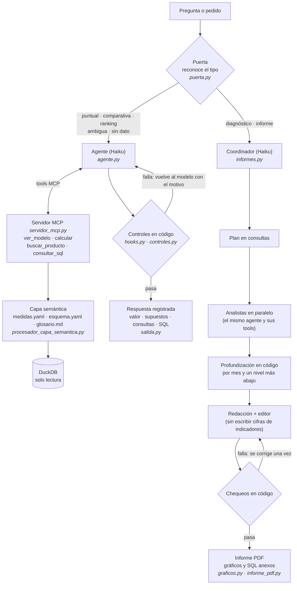

# Arquitectura

La idea que ordena todo el diseño: **el modelo elige qué medir; el código mide.** Haiku interpreta la pregunta y decide la medida, los filtros y el período. La fórmula, el SQL, las variaciones, los gráficos y los controles los pone el código. Así, un número no puede salir de una cuenta del modelo, y cada uno queda registrado con la consulta que lo produjo.

## El flujo de una pregunta

1. **La puerta** (`puerta.py`) hace una llamada corta a Haiku que reconoce el tipo de la pregunta, uno de siete. El código decide el camino: las preguntas que se responden con pocas consultas van al agente; los diagnósticos y los informes, al coordinador (decisión 78). Elige el camino correcto en 192 de 192 casos ([test 8](../trazas/matriz_puerta.md)).
2. **El agente** (`agente.py`) es un loop de Haiku con las tools de un servidor MCP propio, caché del prefijo y salida estructurada. Corta a las 10 llamadas al modelo.
3. **La capa semántica** (`Data/capa_semantica/`) define cada medida una sola vez: `medidas.yaml` (qué se calcula), `esquema.yaml` (sobre qué tablas y joins) y `glosario.md` (con qué criterio: año fiscal de mayo a abril, comparables, devoluciones, «el margen» es %). `calcular()` arma el SQL desde ahí, con los valores de los filtros como parámetros, y calcula las variaciones, participaciones y desvíos. El SQL directo (`consultar_sql`, solo `SELECT`) queda para lo que la capa no cubre, como las promociones vigentes en un mes.
4. **Los controles** frenan en código lo que el prompt no garantiza:
   - **antes de cada tool** (`hooks.py`): cada agente solo puede usar sus tools, y `consultar_sql` acepta un único `SELECT`;
   - **al terminar** (`controles.py`): ningún número sin respaldo en una consulta; si la pregunta nombra una categoría o región, alguna consulta tiene que usarla; un período o un valor que la base no tiene no se responde con números de otro. Si un control falla, la respuesta vuelve a Haiku con el motivo.
5. **El registro** (`salida.py`, `registro.py`): cada respuesta se valida contra un esquema y se guarda con su valor, unidad, supuestos, consultas, SQL y cuentas. Cada llamada al modelo queda con su costo, tokens y tiempo.

## Diagnósticos e informes

El coordinador (`informes.py`) **planifica en consultas, no en temas** (decisión 47). Cada consulta se la encarga a un analista, que es el mismo agente con las mismas tools, como una pregunta suelta, y los analistas corren en paralelo. Después, el código abre la medida principal por mes y baja un nivel en el grupo que más bajó (decisión 113). Haiku redacta el mensaje, el porqué y los rótulos, **sin escribir las cifras de los indicadores**. Un editor lo lee como lo leería el gerente. Antes del PDF, el código controla que cada cifra cite su consulta y que cada gráfico muestre lo que dice el texto. Los gráficos los elige el código según la forma del resultado.

El PDF es de dos páginas: el mensaje como título, 2 o 3 puntos con su prueba, los gráficos y el anexo de las consultas. El SQL completo va en un archivo al lado. En [`docs/informes/`](informes/) están los tres pedidos del enunciado, cada uno con su PDF, su SQL y su traza.

**Informes programados** (`informe_programado.py` y `programado/`): un temporizador de systemd lo corre los lunes a las 8. Elige los informes por calendario real (semanal, mensual, trimestral y anual) y no corre si la base no pasa `verificar_base.py`.

## Datos nuevos

`verificar_base.py` corre 41 controles de integridad y de valores raros después de cada ingesta: claves, joins, signos, duplicados, presupuesto sospechoso y textos con forma de instrucción. Los valores válidos de cada dimensión y el rango de fechas salen de la base al arrancar, no están escritos en el código (decisión 62). La guía para cargar datos nuevos está en [`Data/base/INGESTA.md`](../Data/base/INGESTA.md).

## Interfaz

`interfaz.py` (Streamlit) tiene un chat a la izquierda y, a la derecha, de dónde sale cada número: la consulta explicada en castellano, su SQL, su resultado, los supuestos y los controles que pasó. Una segunda pestaña muestra los resultados de los tests, leídos de `trazas/`. También hay un chat en la terminal (`puerta.py` sin argumentos), donde «?» muestra el origen de cada número.

## Módulos

| Archivo | Qué hace |
|---|---|
| `interfaz.py` | interfaz Streamlit: chat, evidencia de cada número, resultados de los tests |
| `puerta.py` | entrada: tipo de la pregunta, agente o coordinador; chat en la terminal |
| `agente.py` | loop de Haiku con las tools MCP, caché y salida estructurada |
| `servidor_mcp.py` | tools `ver_modelo`, `calcular`, `buscar_producto`, `consultar_sql`; el glosario como prompt |
| `procesador_capa_semantica.py` | arma y corre el SQL de cada medida desde los YAML |
| `hooks.py` | antes de cada tool, después y al terminar; tools permitidas por agente |
| `controles.py` | ningún número sin respaldo; filtros, períodos y valores nombrados |
| `salida.py` | esquema y validación del registro de cada respuesta |
| `informes.py` | coordinador, analistas, profundización, redacción, editor y chequeos |
| `graficos.py`, `informe_pdf.py` | gráficos y PDF, todo en código |
| `chequeos_informes.py` | califica con código lo que tienen que decir los informes medidos |
| `informe_programado.py` | informes por calendario real |
| `explicar.py`, `sugerir.py` | cada consulta en castellano; la pregunta siguiente |
| `verificar_base.py` | controles de integridad después de una ingesta |
| `evaluador.py`, `correr_todo.py` | evaluación contra lo esperado; todo con un comando |
| `registro.py` | costo, caché y tiempo de cada llamada |
