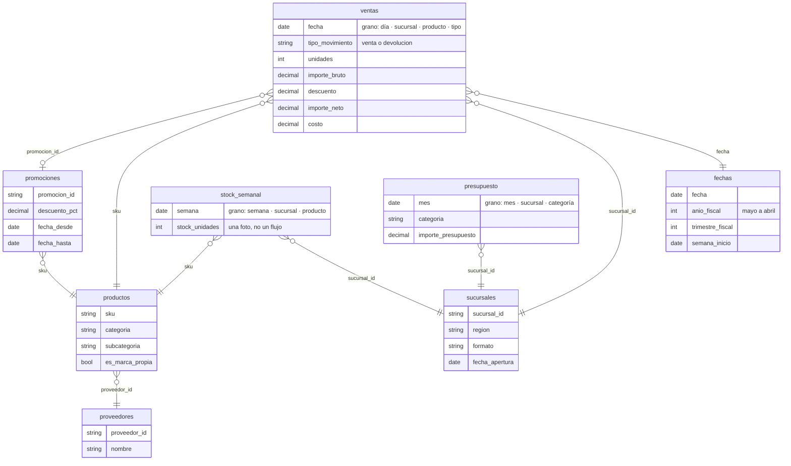

# Los datos

**Almacenes del Sur** es una cadena ficticia de 40 sucursales en cuatro regiones. La base (`Data/base/almacenes_del_sur.duckdb`, DuckDB, solo lectura) cubre dos años fiscales, de mayo de 2024 a abril de 2026: 2,8 millones de filas de ventas, stock semanal y presupuesto mensual.

## Modelo

Tres tablas de hechos, **cada una con su propio grano**, y cinco dimensiones. La base no declara claves foráneas: cada join se verificó contra los datos, y `verificar_base.py` lo vuelve a controlar en cada ingesta.

| Tabla | Filas | Grano |
|---|---|---|
| `ventas` | 2.802.796 | día · sucursal · producto · tipo de movimiento |
| `stock_semanal` | 807.119 | semana · sucursal · producto |
| `presupuesto` | 5.598 | mes · sucursal · categoría |
| `fechas` | 730 | día, con el calendario fiscal |
| `productos` · `sucursales` · `proveedores` · `promociones` | 308 · 40 · 16 · 133 | maestro |

## Lo que encontré y lo que decidió

Antes de escribir el agente revisé las 8 tablas y sus joins contra la base. La estructura está limpia: los joins calzan y no duplican filas, no hay nulos ni claves repetidas, los signos son coherentes y el precio de cada venta coincide con `precio_lista`. Cada característica de los datos terminó en una decisión de diseño:

| Lo que encontré | Lo que decidió |
|---|---|
| Tres tablas de hechos con distinto grano | El desvío contra presupuesto solo se abre por mes, sucursal o categoría; `calcular()` rechaza las dimensiones que no están en el join de cada medida (decisión 15). El stock es una foto semanal, no se suma en el tiempo. |
| Sin claves foráneas declaradas | Cada join verificado a mano, y controlado en cada ingesta por `verificar_base.py`. |
| 308 productos con 282 descripciones: hay nombres repetidos | Se filtra por sku, nunca por nombre; `buscar_producto()` pasa de un nombre a su código (decisión 33). |
| S39 y S40 abrieron dentro del período (jun y jul de 2025) | Sucursales comparables, aplicadas por el código con `comparables=True` (decisión 12). |
| Año fiscal de mayo a abril | El criterio está en el glosario y en la tabla `fechas`; el test de fechas lo prueba (42 de 42). |
| Devoluciones con signo negativo | Se netean en las ventas netas, no se suman aparte. |
| `promociones`, sin documentar, la usan 28.793 ventas | Se incorporó a la capa. |
| 1.749 ventas con margen negativo | No son un error: son promociones con 20–25 % de descuento. |
| Quiebre de stock normal, mediana de 1,32 % | Un quiebre se compara con las semanas vecinas, no con un umbral fijo. |
| La primera y la última semana tienen 5 y 4 días | Por semana parecen caídas: está escrito en el esquema, y ante una caída el diagnóstico mira primero si faltan días (decisión 93). |
| Un error de carga: el presupuesto de ene-2026, Perfumería, región Sur, viene ×10 | El código avisa cuando un desvío incluye un presupuesto sospechoso (decisión 84). |
| Un producto cuyo texto tiene forma de orden para el asistente (P0040) | Se trata como dato, nunca como instrucción, y `verificar_base.py` lo marca (decisión 57). |

La base también tiene eventos reales que el agente tiene que saber explicar: la suba de costo del proveedor PR01 desde ago-2025, la caída de las comparables del Oeste desde la apertura de S39 y el quiebre de stock de PR09 en el Norte en sep-2025. **Al agente se le da el criterio de dónde mirar, no estos hallazgos** (decisión 7): si los supiera de antemano, la evaluación no mediría nada.

El análisis completo, con un gráfico por cruce, está en [`diagramas/modelo_de_datos.md`](diagramas/modelo_de_datos.md) (el canvas original, [`Modelo de datos.canvas`](diagramas/Modelo%20de%20datos.canvas), se abre con Obsidian).

## Las preguntas

Casi todas las preguntas siguen la forma **qué + de qué + cuándo**: qué se mide (la medida), de qué (los filtros: cadena, categoría, región…) y cuándo (el período). Es el mismo formulario que el modelo completa en `calcular()`. Las trampas suelen estar en palabras que define el glosario: en «¿Cuánto vendió la cadena en el AF2025?», «vendió» son ventas netas, no brutas, y el AF2025 va de mayo de 2024 a abril de 2025, no es el año calendario.

La capa semántica (`Data/capa_semantica/`) es la versión trabajada de la del curso; `medidas_original.yaml` es la copia original, sin tocar, para comparar.

En `Data/preguntas/` están las 20 preguntas, las 5 conversaciones y los 3 pedidos de informe del enunciado, junto con los valores esperados (`esperados.yaml`), calculados con SQL escrito a mano.
