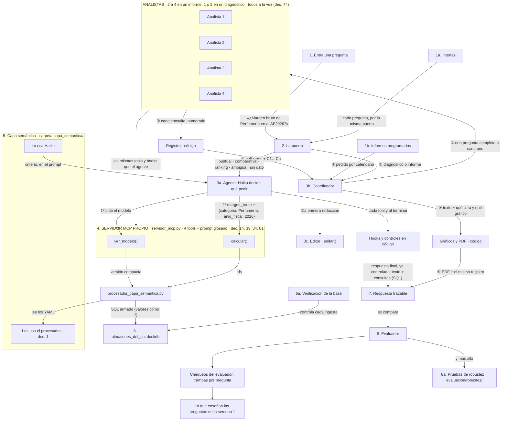

# Diseño del agente

Versión para leer en GitHub del canvas [`Diseño del agente.canvas`](Diseño%20del%20agente.canvas) (que se abre con Obsidian): el diagrama con sus flechas y, abajo, el texto de cada tarjeta. Es el canvas de trabajo del proyecto: los resultados al día están en [evaluacion.md](../evaluacion.md).



### Diseño del agente: el recorrido de una pregunta

De izquierda a derecha: **entra** una pregunta (por el chat, la **interfaz** o un informe programado) → la **puerta** reconoce el tipo y elige el camino → **arriba**, el camino simple (el agente elige qué pedir y el código calcula) · **abajo**, el multi-agente (el coordinador reparte entre analistas y redacta) → los dos terminan en una **respuesta trazable** que mide el **evaluador**. Al pie: el avance por semana y el porqué del diseño multi-agente.  
🟩 **hecho** · 🟪 **en curso** · sin color: entradas y datos · *dec. N* = decisión N de `docs/decisiones.md` · ①…⑥ = el recorrido de un informe

## El recorrido

### 1. Entra una pregunta

Lo que el agente tiene que resolver:
- **P01–P20**: puntuales, comparativas, rankings, diagnósticos, ambiguas y sin dato
- **C1–C5**: conversaciones de 3 turnos
- **I1–I3**: pedidos de informe en PDF

El tipo no viene escrito: reconocerlo es parte del trabajo → lo hace la **puerta** · *dec. 78*

### 1a. Interfaz · interfaz.py

*Semana 7 · dec. 101–103.* Streamlit, mínima: la misma puerta que el chat de la terminal (`puerta.py` sin argumentos).
- **Izquierda:** el chat; debajo de cada respuesta, tipo → camino, costo y tiempo, y lo que **supuso**
- **Derecha, «De dónde sale»:** cada consulta en castellano (qué se midió, de qué, cuándo), su **SQL** y su **resultado**, y los **controles que pasó**
- **Pregunta siguiente:** 2 o 3 botones, armados por reglas, sin modelo; con memoria de la conversación, no se repiten · *dec. 86, 103, 121*
- **Generar informe:** sobre la conversación del chat, el semanal, el mensual u otro escrito; el PDF se baja solo
- **Cómo sé que funciona:** el resultado de cada test

Bibliografía: Microsoft (Amershi, CHI 2019: qué puede y qué tan bien), Google PAIR (calibrar la confianza), Databricks Genie y Snowflake Cortex (mostrar el SQL), Gu y otros (CHI 2024). Colores: tema oscuro de Material Design, contraste WCAG.

### 1b. Informes programados · informe_programado.py

*Semana 4 · dec. 64–66.* Lo lanza un timer de systemd **los lunes a las 8**, sin nadie al lado. Si la base no pasa la verificación o faltan datos, avisa.

Cada uno responde **otra pregunta**:
- **Semanal:** qué requiere atención (quiebre por región y proveedor, caídas)
- **Mensual:** cumplimiento del presupuesto
- **Trimestral:** por qué se movió el margen
- **Anual:** de dónde vino el crecimiento

Ejemplo: `trazas/I_semanal_programado.pdf`

### 2. La puerta · puerta.py

*Semana 5 · dec. 78.* **Una sola entrada** para preguntas, conversaciones y pedidos de informe.

Una llamada corta a Haiku **reconoce el tipo** (técnica del módulo 6: tool forzada con enum, primero el motivo, validado con pydantic). El **código** elige el camino:
- puntual · comparativa · ranking · ambigua · sin dato → **agente**
- diagnóstico · informe → **coordinador**

Criterio: diagnóstico es cuando la pregunta **no dice qué dimensión mirar**. «¿Qué proveedor explica la diferencia?» va al agente: lo resuelve con una consulta.

En una conversación recibe los turnos anteriores (y el coordinador, también sus respuestas). Después de un diagnóstico, el agente recibe en su historial **las consultas de los analistas**: si no, el hook frenaba las cifras del diagnóstico.

- El **tipo de la puerta manda**: el coordinador no lo cambia
- Si Haiku se niega a clasificar → va al agente y queda anotado

Medido: **33 de 33** en la ruta, tres veces · US$ 0,005 los 33 casos. Apartadas: el camino bien en las 5 · *dec. 79*

**Matriz de confusión** · *dec. 99*: 64 preguntas × 3 → **camino correcto 192 de 192**, tipo exacto 96 %. Los errores de tipo caen siempre dentro del mismo camino (la ambigua leída como puntual: el agente igual declara la lectura)

### 3a. Agente: Haiku decide qué pedir

`agente.py` · `claude-haiku-5-5`, el loop de siempre:
1. Lee la pregunta
2. **Traduce las palabras a ids** con lo que le dio `ver_modelo` (descripciones, sinónimos, valores válidos, glosario) · *dec. 3*
3. **Elige la métrica y los filtros** (no escribe la fórmula) · *dec. 2*
4. Llama a una tool → el código la ejecuta
5. Responde con lo que volvió

**Prompt de sistema:** cada número sale de `calcular` · código y nombre al nombrar sucursales o proveedores · al comparar ventas, total y comparable · *dec. 18* · más el glosario

**Conversaciones:** cada turno recibe el historial de los anteriores · *dec. 31*

**Hooks** · `hooks.py` · *dec. 58–60*: antes y después de cada tool y al terminar (card *Hooks*, abajo). Tools **permitidas por agente**, en el código.

**Respuesta final por salida estructurada** (`salida.py`): texto, valor, unidad, supuestos, cuentas · *dec. 73*

**Caché** del prefijo (tools + sistema) · *dec. 72*

**Corta a las 10 llamadas** al modelo si no llega a una respuesta (hoy usa 2 o 3) · *dec. 26*

Así no confunde bruto con neto ni fiscal con calendario.

### 3b. Coordinador

Un solo agente, **dos llamadas**: primero parte el pedido, después redacta. **Sin acceso a la base.**

##### Llamada 1 · parte el pedido (sale ②)
*Semana 3 · informes y diagnósticos* · `claude-haiku-5-5`

Parte el pedido en preguntas **completas e independientes**: 1–2 en un diagnóstico, 2–4 en un informe. Cada encargo lleva **objetivo, formato y límites**. Ejemplo I1:
- «¿Cómo vino el margen % por categoría y qué proveedor explica la que más cayó?»
- «¿Cómo vinieron las ventas?» (contexto)

**Hecho** · `informes.py` · *dec. 47*: cada encargo lista sus **consultas (1 a 3)**, sin tablas ni cuentas que el código no hace. `revisar()` (código) controla los límites: si no cumple, el coordinador **corrige una vez** con los problemas; si sigue mal, no va a los analistas · *dec. 75*

##### Llamada 2 · redacta (recibe ④, sale ⑤)
Con los hallazgos y las consultas registradas escribe: **título = mensaje**, una **bajada** con su escala (máx. 2 cifras), y **2 o 3 razones**, cada una con su prueba (el gráfico **cita una consulta**, C3). Sin «qué hacer»: decidir es de la gerencia · *dec. 104, 105*
- **La historia entera:** si dos medidas van al revés (margen % baja, en pesos sube), el título dice las dos · *dec. 105*
- % y pp como en una empresa: el lector es **un gerente que sabe de números**
- Ejemplos en el prompt **aprobados por el usuario** (`Data/ejemplos_informes/`): una semana sin novedades y la marca propia, completos; del margen, solo lecciones. **Ningún ejemplo nombra los eventos de la base**: los cuatro son respuesta de casos medidos · *dec. 107, 108*

**Hecho** · `redactar()` · *dec. 51, 104, 105*. El código revisa antes del PDF: consultas que existen, cada número con respaldo, título ≤ 22 palabras y oraciones ≤ 30 (*dec. 108*), «cinco proveedores» = cinco resaltados, **el número de una razón se ve en su gráfico**. Lo que encuentra va **junto con lo del editor** (card al lado) en una sola corrección. Tres informes: ~US$ 0,05.

Tools: **ninguna** (el menú de medidas va en su prompt).

### 3c. Editor · editar()

*Semana 7 · dec. 105.* El patrón **evaluador-optimizador** del módulo 4. Después de la primera redacción, **Haiku en una llamada aparte**, que ve **solo la página** (sin los datos ni el razonamiento del coordinador), la lee como el gerente:
- ¿el título dice qué pasó y por qué, completo?
- ¿cada número dice contra qué se compara?
- ¿algo se dice dos veces? ¿alguna oración suena rara?
- ¿cada razón sostiene el título?

Devuelve hasta 4 arreglos **con la frase propuesta**; van al coordinador junto con lo del código, en **una sola corrección**.

Sustento: DataNarrative (EMNLP 2024: agente + crítico > un paso), Self-Refine (NeurIPS 2023: crítica específica > genérica). Límites: un modelo favorece su propio texto (NeurIPS 2024) y no se autocorrige sin señal externa (ICLR 2024) → **no aprueba nada**, los números los controla el código y el juez es el usuario.

### Analista 1

Ejemplo semanal: el quiebre por región y por proveedor.  
Es **el agente 3a con una sola pregunta**: mismo loop, mismas tools del MCP. El **único que consulta**. Cada llamada arranca de cero.

Devuelve su hallazgo en 2–3 renglones.

**Hecho** · `investigar()` · *dec. 48*. I1: 4 analistas, 10 consultas, US$ 0,0145, 56 s.

⚠️ Puede leer la descripción de P0040 (texto con forma de instrucción) y su hallazgo va al coordinador: la separación lo limita, no lo impide. Probado · *dec. 57*: Haiku la ve, no la sigue y avisa. Lo que no depende del modelo: el control no deja salir un número sin respaldo, y de los textos solo toma tamaños («300 g»), no el «50 %» de la nota.

### Analista 2

Igual que el 1: mismo loop, mismas tools, arranca de cero. Otra pregunta del plan.

Ejemplo semanal: las sucursales que más cayeron.

### Analista 3

Igual que el 1: mismo loop, mismas tools, arranca de cero. Otra pregunta del plan.

Ejemplo semanal: los productos con caída fuerte.

### Analista 4

Igual que el 1: mismo loop, mismas tools, arranca de cero. Otra pregunta del plan.

Ejemplo semanal: *(no hay: el semanal tiene 3 preguntas)*. Solo existe si el plan tiene 4.

### ver_modelo()

Devuelve la **versión compacta**: métricas (id, nombre, **descripción**, sinónimos, unidad), dimensiones con valores válidos. Sin fórmulas, joins ni reglas · *dec. 3, 16, 21* · ~1.700 tokens · más `tablas_para_sql` · *dec. 34*

##### `buscar_producto(texto)` · `consultar_sql(sql)`
Nombre → sku · *dec. 33*. SQL solo para lo que la capa no cubre (promociones vigentes), sin acceso a archivos · *dec. 34*

### calcular(medida, filtros, agrupar_por, orden, limite, comparar_con, comparables)

**El camino principal.** Arma el SQL desde los YAML, lo corre y devuelve **número + SQL**.
- `agrupar_por` + `orden` + `limite` → rankings · *dec. 10*
- `comparar_con` → comparativa en una llamada · *dec. 11*
- `comparables=True` → solo sucursales abiertas · *dec. 12*
- `comparar_con` + `agrupar_por` → por grupo, variación y **aporte** a la suba total · *dec. 28*
- Filtro con **lista** (`mes: [1, 2, 3]`) → trimestre calendario, varias regiones · *dec. 23*
- `agrupar_por` en medida aditiva → **participación** y total · *dec. 29*
- `desvio_presupuesto_pct` → ventas y presupuesto, el % lo hace el código · *dec. 30*
- Comparación aditiva → también la **diferencia** del total · `efectos_margen` → efecto precio y costo, y suba % de precio y costo · *dec. 43, 50*
- Período de días como **rango** `{fecha: {desde, hasta}}`; dos fechas salteadas → error · *dec. 69*
- **Valida los valores**: «perfumeria» → error con los válidos · *dec. 25*
- Si falla, Haiku recibe el motivo · *dec. 14*

### Los usa el procesador · *dec. 1*

- `medidas.yaml`: **qué** se calcula (fórmulas y si es `aditiva`; sin reglas) · *dec. 21, 28*
- `esquema.yaml`: **sobre qué datos** (tablas, alias, joins, dimensiones; `dimensiones_propias` · *dec. 22*)

Completos para el código; a Haiku le llega una versión compacta por `ver_modelo`.

Medidas por unidad: precio promedio, costo por unidad y **margen por unidad** (este, *dec. 112*: para comparar productos que se reemplazan, sin SQL directo).

Valores válidos y rangos: **se leen de la base** al arrancar, para que una ingesta entre sola · *dec. 62*

### Lo usa Haiku

- `glosario.md`: **con qué criterio** (ventas = netas, AF desde mayo…)

**Única fuente de criterio** (también «margen bruto» = pesos, «el margen» = %) · *dec. 20, 21*

No pasa por el procesador: lo sirve el **servidor MCP como prompt** `glosario` y va en el prompt de sistema (~1.360 tokens) · *dec. 61*

Quiebre: se compara con la misma semana del año anterior, no con un número fijo · *dec. 77*

### procesador_capa_semantica.py

**Hecho:** resuelve las 10 preguntas de la semana 1 ✅  
No lee la pregunta: **busca los ids** en los YAML, cargados como diccionarios (buscás por id y te da todo).
1. `MEDIDAS["margen_bruto"]` → fórmula y tabla
2. tabla → join completo · *dec. 9*
3. `dimensiones["categoria"]` → `p.categoria = ?` (en presupuesto, `pz.categoria` · *dec. 22*)
4. Corre el SQL → **número + SQL**  
Id o valor que no existe → error con los válidos, no inventa · *dec. 25*

También `ver_modelo()`: lee los mismos YAML y arma la **versión compacta** (sin fórmulas ni joins).

### 6. almacenes_del_sur.duckdb

**Solo lectura.** 8 tablas, ventas = 2,8 M filas. Demasiado grande para el prompt: se consulta por tools.

**Admite ingestas** (en una copia): `verificar_base.py` revisa joins y fechas · guía `INGESTA.md` · *dec. 62, 63*

### 6a. Verificación de la base · verificar_base.py

*Dec. 62–63, 85, 92.* Después de cada ingesta, y antes de cada informe programado.
- **Errores, bloquean:** joins, claves, calendario fiscal, importes que no cierran, valores imposibles (41 controles)
- **Avisos, no bloquean:** saltos contra los vecinos (**umbral por serie**: 1,5 en presupuesto y costo, 3 en ventas del día), días sin ventas, fotos de stock repetidas, textos con forma de orden

Medido (*dec. 89, 91*): **420 de 420** errores con control, 30 semillas; un ×2 en presupuesto o costo se ve siempre; queda un punto ciego conocido (un día sin una categoría).

### Hooks y controles en código · hooks.py, controles.py

*Semana 4 · dec. 58–60.* Si un hook frena, Haiku recibe el motivo como error de una tool y corrige.
- **Antes de cada tool:** solo las tools permitidas a ese agente · `consultar_sql` solo un `SELECT` (lo dice el parser de DuckDB)
- **Después de cada tool:** registra la consulta con su SQL (C1, C2…)
- **Al terminar** (hasta 2 correcciones, compartidas):
  - ningún número sin respaldo en una consulta · *dec. 49* (rangos y escala «1.722,1 millones frente a 1.825,6» · *dec. 82, 105*)
  - una **categoría o región** que nombra la pregunta tiene que estar en alguna consulta · *dec. 95* («Almacén:» se leía como la empresa: 81 → 84 de 84)
  - un **período escrito fuera de la base** no se responde con números de otro · *dec. 97* (fuera de la base: 6 → 9 de 9)

Lo que tiene que pasar **siempre** va en código, no en el prompt (módulo 4: la capa de instrucción es la única probabilística).

Medido: frenó 261 respuestas de 239 preguntas; en 234 Haiku corrigió · `trazas/hooks.md`

### Registro · código

Cada resultado de una tool queda con su número **C1, C2…**, con medida, filtros y SQL (`sqls()`). Lo numera el código: ningún agente puede inventar ni renumerar una consulta.

**Traza** · `--traza` · *dec. 56*: plan, vueltas y errores de cada analista, consultas con SQL, lo que encontró el control y el costo de cada paso (`trazas/I1.md`, `trazas/P16.md`).

### Gráficos y PDF · código

`graficos.py` · *dec. 40*: el PNG sale del resultado citado. **El tipo lo elige el código por la forma de la consulta** · *dec. 106, 107*: dos períodos por mes → dos líneas; por mes y 2–4 grupos → una línea por grupo; muchas sucursales o productos → columnas ordenadas; grupo × sí/no → pesas; tiempo × grupo que se suma → apiladas.  
`informe_pdf.py` · *dec. 41*: cada cifra con su [Cn]; si cita una consulta que no existe, no se arma.

**Una página, de arriba abajo** · *dec. 104, 105*: identificación → **título (el mensaje, lo más grande)** → bajada → **POR QUÉ**, razones numeradas («→ gráfico 1») → **gráficos con un rótulo que dice qué muestran** (no repite la conclusión). Cada idea aparece **una vez** (Minto, Mayer, Knaflic). Un solo color: el rojo en lo que nombra la razón. Etiqueta: primero lo que mide la barra («−1,2 pp (24,5 %)»).

Página 2: supuestos (sin nombres internos) y anexo **en castellano** (`explicar.py`); el SQL en `consultas.sql`. `--rearmar` rehace el PDF sin llamar al modelo.

**Prueba a ciegas** (19-11): el usuario eligió la versión nueva sin saber cuál era.

**Diagnóstico** · *dec. 55*: texto (`diagnostico.md`): respuesta en una oración, 2–3 de evidencia, siguiente paso.

### 7. Respuesta trazable

```
{ pregunta, texto, valor, unidad,
  supuestos: [...],
  consultas: [{metrica, filtros, sql}],
  cuentas: [...] }
```
**Cada número sale de una consulta registrada.**  
Informes: el mismo registro + PDF.

✅ `--traza trazas/X.md` guarda respuesta + consultas con SQL · *dec. 36*

✅ **Hecho · dec. 73, 78** · también los diagnósticos e informes (con la ruta del PDF o del .md), y cada registro lleva el **tipo** que reconoció la puerta · · `salida.py`: Haiku escribe texto, valor, unidad, supuestos y cuentas con un **esquema JSON fijo**; las consultas las pone el código. Se valida (el valor sale de una consulta y tiene unidad; sin números sin respaldo) y se guarda en `registros/respuestas.jsonl` · *dec. 75*

### 8. Evaluador

Para cada pregunta: **valor esperado y tolerancia**, verificados a mano.
- Valores en `Data/preguntas/esperados.yaml` (salen de la card *chequeos*)
- Tolerancia: la mitad del último dígito verificado (+5,4 % → ±0,05)
- Tipos de chequeo: valor · variación (total o comparables) · ranking (códigos en orden)
- **Pasa si alguna consulta usó la métrica esperada y dio ese valor**: número bien con métrica mal = coincidencia
- Por ahora mira las **consultas**, no el texto de la respuesta
- **Apartadas** P09, P12, P14, P18, P19: se corren una sola vez en la semana 5 · *dec. 5*
- Hallazgos del canvas *Modelo de datos* = respuesta esperada de los diagnósticos · *dec. 7*

- **Conversaciones** C1–C5: un chequeo por turno · *dec. 32* · `fila` para leer una fila agrupada · *dec. 37*
- **P17** (ambigua): vale una lectura si la declara en supuestos · **P20** (sin dato): lo dice, sin responder con otro indicador · *dec. 35, 76*
- **Vuelve a correr las consultas declaradas** y compara SQL y valor, como pide el enunciado · *dec. 75*
- Corre **de a 5 en paralelo** (~45 s; antes ~210 s) · *dec. 74*
- `--veces N`: cada pregunta corre N veces y aprueba solo si pasa todas (Haiku varía) · *dec. 27*
- Hallazgos de los diagnósticos, como comentario en `esperados.yaml` (fuera del esquema) · *dec. 24*

✅ `evaluador.py` · *dec. 19* · primera evaluación: **10 de 10** (2026-10-27) · con `--veces 3`: **10 de 10 las 3 veces** (2026-11-11) · con conversaciones: **17 de 17** · semana 5: **17 de 17**, ~US$ 0,03 por corrida · desde la *dec. 80*: **17 de 17 de trabajo + 4 de 4 de la reserva** (las apartadas, que nunca se usan para ajustar)

**Informes** (I1–I3) · *dec. 110*: `chequeos_informes.py` los califica con código (5 chequeos cada uno, en `esperados_informes.yaml`) y cada versión del diseño se compara en `trazas/comparacion_informes.md`: ejemplos inventados 74 % → aprobados 81 %; un cuarto ejemplo y sacar el de marca propia empatan · *dec. 109, 111*

### Chequeos del evaluador: trampas por pregunta

Lo que tiene que hacer bien el agente en cada pregunta. Sale del estudio de a una. **No se toca la capa por adelantado**: si el agente falla un chequeo, se corrige ahí.

| | chequeo | valor esperado |
|---|---|---|
| P01 | usa `ventas_netas` (no brutas) · AF2025 = may-2024 a abr-2025, no calendario | 9.747.823.869 ARS |
| P02 | usa `unidades` (netas de devoluciones) · filtra el mes de marzo, no el año fiscal | 34.186 unidades |
| P03 | usa `margen_bruto` en pesos (no %) · no lo afecta el error del presupuesto | 460.758.207 ARS |
| P04 | usa `descuentos`, no margen: descontar ≠ perder plata | 9.084.031,50 ARS |
| P05 | cuenta en la tabla `sucursales`, no con `cantidad_sucursales` (esa cuenta las que vendieron) · aclara que "hoy" = datos hasta abr-2026 | 10 sucursales |
| P06 | T3 = nov a ene · compara contra T3 AF2025 · informa la total y aclara comparables (S39 y S40 no existían) | +5,4 % (comparables +2,3 %) |
| P07 | "el margen" = margen % (dec. 8), variación en pp · T2 = ago a oct · muestra también pesos · idealmente lo explica por el costo de PR01 | −1,2 pp (25,67 % → 24,46 %) |
| P08 | da la variación comparable, no la total · comparables = abiertas antes del 01-05-2024 (inicio del período anterior): 38 sucursales, sin S39 ni S40 | +2,1 % (total +4,3 %) |
| P10 | ranking por ventas netas en pesos (en unidades da el mismo top 5) · muestra código, nombre y monto | S02, S11, S21, S01, S22 (6.ª: S31) |
| P11 | ordena por margen en pesos, no % · llega al proveedor por ventas → productos → proveedores | PR11, PR15, PR07 (4.º: PR02) |

### Lo que enseñan las preguntas de la semana 1

**Método:** qué se mide + de qué + cuándo + trampas.

**Tres tipos**
- **Puntual** (P01–P05): un cálculo, un número.
- **Comparativa** (P06–P08): dos cálculos y la variación.
- **Ranking** (P10, P11): agrupar, ordenar, quedarse con N.

**Lo que le faltaba a `calcular()`** (resuelto · *dec. 10–13*)
- Períodos distintos: año fiscal, trimestre fiscal, mes.
- Agrupar y cortar en N.
- Joins encadenados (ventas → productos → proveedores).
- Filtro de comparables (depende del período).
- Contar en una dimensión (sucursales).

**Trampas que se repiten**
- Palabras del glosario: ventas = netas; AF y T3 fiscales.
- Pesos o %: en P07 cambia la respuesta.
- Total o comparables: S39 y S40 inflan el crecimiento.
- Distractores de otra tabla (presupuesto en P03).
- Límites de la base: "hoy" = hasta abr-2026.

**Una buena respuesta** da el número, el criterio usado y el contexto que cambia la lectura (sucursales nuevas, costo de PR01).

### 8a. Pruebas de robustez · evaluacion/robustez/

*Semana 7 · dec. 87–100 y 115–118.* Más allá de las 28 preguntas del curso. Calificadas **por código**, con valores calculados con SQL **antes** de correr el agente; si algo falla, se reporta (y si se corrige, es diseño general, no un parche).
- **Datos nuevos:** un mes y un **año simulados** con cosas que nunca pasaron → el agente, **10 de 10**; el diseño no sabe de cierres ni de cambios de precio
- **Lenguaje:** la misma pregunta de 4 maneras → **84 de 84**
- **Fechas:** año fiscal, «el mes pasado», ambiguas, fuera de la base → **42 de 42**
- **Ataques:** por capas (hook, conexión, base) → **14 de 14** y la base intacta
- **La puerta:** matriz de confusión → camino **192 de 192**
- **Costo:** una pregunta ~US$ 0,001 y < 10 s; un informe ~US$ 0,020
- **No inventar:** preguntas que la base no responde → **26 de 36**; nunca inventa el dato
- **Consistencia:** cada caso 10 veces → **170 de 170**
- **Conversación:** qué arrastra y qué suelta → **69 de 72**

## Por qué el diseño multi-agente

### Por qué así

**2 tipos de agente:** coordinador y analista (el agente de siempre). Planificar y redactar no tocan la base: separarlos no agrega seguridad. **Quien escribe no consulta y quien consulta no escribe.**

**Tareas cortas y completas.** El modelo relee todo en cada vuelta: medido, 5 vueltas = 54.000 tokens de entrada; el mismo trabajo en 2 tareas de 3 vueltas ≈ 38.000. Preguntas que dependen entre sí (la categoría que más cayó → sus proveedores) van en **una** pregunta.

**Igual que lo que se usa:** Anthropic (agente principal + subagentes en paralelo, cantidad según el pedido, encargos con objetivo, formato y límites); Wobby (los agentes solo consultan la capa semántica, sin redes de agentes que conversan entre sí).

**Descartado:** un solo agente para todo · analistas fijos por tema · una sola conversación para todas las preguntas.

**Semana 4:** ✅ las tools de cada agente están en una lista en el código · *dec. 60*

### Qué puede hacer cada uno

| | Coordinador | Analista | Código |
|---|---|---|---|
| Ver medidas (`ver_modelo`) | ✅ | ✅ | |
| Consultar la base | ❌ | ✅ | |
| Numerar consultas | ❌ | ❌ | ✅ |
| Escribir el texto | ✅ | solo su hallazgo | ❌ |
| Hacer cuentas | ❌ | ❌ | ✅ |
| Gráficos y PDF | elige | ❌ | ✅ |

✅ Impuesto por código: `PERMITIDAS` por agente · *dec. 60*

### Costo por informe y registro

**Hecho** · `registro.py` · *dec. 45, 46*: una línea por llamada al modelo en `registros/llamadas.jsonl` (tokens, caché, US$, segundos, tools, errores) con la **versión del diseño** que corría. `registro.py --comparar A B` mide qué le hizo cada cambio al costo, el tiempo y los aciertos.

Ejemplo, dec. 50: la corrida del evaluador bajó de US$ 0,087 a 0,066.

✅ **Caché, medido** · *dec. 72*: el evaluador bajó de US$ 0,073 a ~0,03. Un informe: US$ 0,016–0,031.

## Avance por semana

### Semana 2 · Cuentas, criterio, conversaciones

- Variación, participación y gráficos los arma **código**, no el modelo
- Pregunta con dos lecturas → **preguntar o declarar el supuesto**
- Sin dato en la base → decirlo, **no responder con otro indicador**
- Conversación: "¿Y en el Sur?" **hereda** período, filtros y métrica

**Avance:** completa
- ✅ Cuentas: aporte, participación y desvío · *dec. 28–30*
- ✅ Conversaciones C1–C5 · *dec. 31–32*
- ✅ Ambigua: da las dos lecturas · sin dato: lo dice · *dec. 35*
- ✅ Trazas: `trazas/P17.md`, `P20.md`, `C1.md` · *dec. 36*
- ✅ Gráficos: los arma el código en los informes · *dec. 40*

### Semana 3 · Diagnósticos e informes

- **Patrón multi-agente** para descomponer, consultar y redactar: cuántos agentes y qué puede hacer cada uno
- Guía de **dónde mirar** según la situación · *dec. 7 (criterio decidido)*
- ⚠️ En `productos` hay **datos con forma de instrucción**: tratarlos como datos
- Medir el **costo de cada informe**

**Avance (2026-11-13):** completa · *dec. 38–57* (detalle en el grupo de abajo)

### Semana 4 · Corre solo

- Glosario servido como **prompt del MCP**
- **Hooks** antes y después de cada tool y al terminar:
  - frenar todo lo que no sea `SELECT` (solo si vuelve `consultar_sql`: hoy Haiku no escribe SQL)
  - no dejar salir un número que no esté en ninguna consulta o cuenta ✅ adelantado en la semana 3 (*dec. 49*)
- **Tools permitidas por agente**, impuestas por código

**Avance (2026-11-16):** completa
- ✅ Hooks · *dec. 58–59* · traza `trazas/hooks.md`
- ✅ Tools por agente · *dec. 60* · glosario como prompt · *dec. 61*
- ✅ Ingesta de datos nuevos · *dec. 62–63*
- ✅ Informes programados · *dec. 64–66*

### Semana 5–6 · Estructura y corrida

- Registro por **salida estructurada**, validado antes de guardarse
- **Caché** del prefijo estable (mirar `cache_read_input_tokens`)
- Corridas en paralelo; ¿**Batch API**?
- Semana 6: todo con **un comando**, con costo y tiempo

**Avance (2026-11-17):**
- ✅ Caché · *dec. 72* · salida estructurada · *dec. 73*
- ✅ Paralelo; Batch API descartada (el loop encadena llamadas; ahorro < US$ 1 por año) · *dec. 74*
- ✅ Revisión total · *dec. 75–77*
- ✅ Una sola puerta de entrada · *dec. 78*
- ✅ Apartadas abiertas: pasan las 5; quedan como **reserva** · *dec. 79, 80*
- ✅ Todo con un comando: 28 casos, US$ 0,10, 2 min · *dec. 81*
- ✅ Chat en la terminal, consultas en castellano, datos sospechosos, pregunta siguiente · *dec. 83–86*

### Semana 7 · Robustez, interfaz y comunicación

- ✅ Pruebas de robustez: ingesta, lenguaje, fechas, ataques, puerta, costo · *dec. 87–100*
- ✅ Controles en código: categoría o región sin usar, período fuera de la base · *dec. 95, 97*
- ✅ Interfaz en Streamlit · *dec. 101–103*
- ✅ Informes: cada idea una vez, la historia entera, un editor · *dec. 104, 105*
- ✅ **20-11:** ejemplos del coordinador aprobados por el usuario (dos al prompt) e informes calificados con código · *dec. 106–111*
- ✅ Las pruebas que faltaban: no inventar, consistencia y conversación · *dec. 115–118*
- ✅ **23-11:** repo ordenado, tests unitarios sin modelo y timeout del cliente · *dec. 119*
- 🟪 Guion de la defensa
