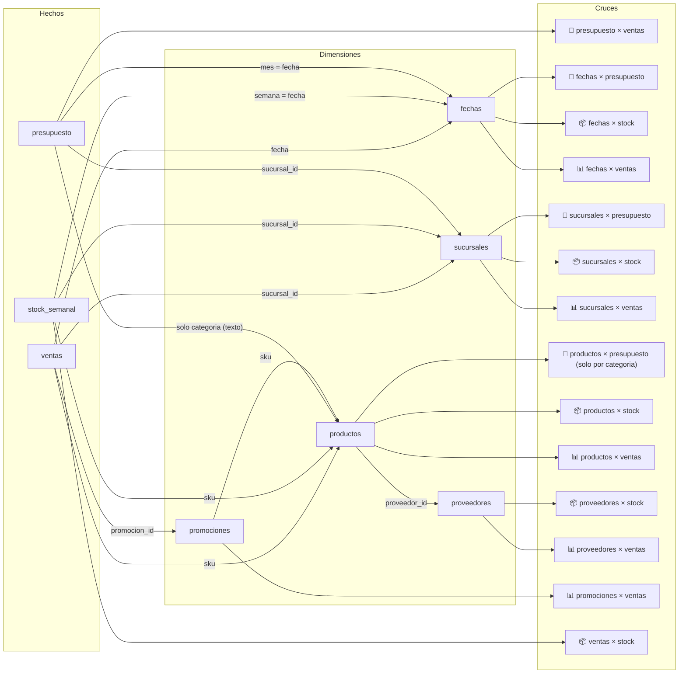

# Modelo de datos

Versión para leer en GitHub del canvas [`Modelo de datos.canvas`](Modelo%20de%20datos.canvas) (que se abre con Obsidian): el esquema con sus joins y, abajo, cada tabla y cada cruce entre tablas, con lo que se encontró en los datos. El resumen está en [datos.md](../datos.md).

### Modelo de datos: almacenes_del_sur.duckdb

**Esquema estrella.** Al centro, los **hechos** 🟧 (lo que pasó, con números que se suman). Alrededor, las **dimensiones** 🟦 (quién, qué, dónde y cuándo: sirven para filtrar y agrupar).  
Cada flecha es un join: el hecho guarda el **código** y la dimensión lo traduce a atributos. 🔑 = clave de la tabla · ➜ = código que apunta a otra tabla.

## Hechos

### ventas

Cada fila es lo que se vendió (o devolvió) de un producto, en una sucursal, en un día.

*2,8 M filas · día × sucursal × producto × tipo*  
ARS constantes de abr-2026, sin impuestos.

| columna |  | ejemplo |
| --- | --- | --- |
| `fecha` | ➜ fechas · día del movimiento | 2025-12-20 |
| `sucursal_id` | ➜ sucursales | S02 |
| `sku` | ➜ productos | P0071 |
| `tipo_movimiento` | venta / devolucion (devolución: todo **negativo**) | venta |
| `unidades` | **número** | 31 |
| `importe_bruto` | **número** · unidades × precio de lista | 92.380 |
| `descuento` | **número** · solo si hay promoción | 23.095 |
| `importe_neto` | **número** · bruto − descuento = **«ventas»** | 69.285 |
| `costo` | **número** · costo **total** de la fila, de reposición | 72.825 |
| `promocion_id` | ➜ promociones (o vacío) | PROMO001 |

**Devoluciones:** 0,4 % de las filas · 0,24 % del importe  
✅ bruto − descuento = neto en todas · sin duplicados · sin unidades en 0  
⚠️ **1.749 ventas por debajo del costo**, todas con promoción (ver promociones)

### stock_semanal

Cada fila es cuántas unidades de un producto había en una sucursal el lunes de cada semana.

*807 k filas · lunes × sucursal × producto*

| columna |  | ejemplo |
| ---------------- | ------------ | --- |
| `semana` | ➜ fechas | 2025-12-15 |
| `sucursal_id` | ➜ sucursales | S02 |
| `sku` | ➜ productos | P0071 |
| `stock_unidades` | **número** | 311 |

**104 lunes** (06-05-2024 a 27-04-2026) · S39 desde 02-06-2025, S40 desde 07-07-2025  
Solo están los pares sucursal × SKU que se venden: **7.954 de 12.320**  
**Unidades:** mediana 9 · máx. 386 · sin negativos · **en 0 (quiebre):** 1,4 % de las filas

### presupuesto

Cada fila es cuánto debería vender una sucursal de una categoría en un mes.

*5.598 filas · mes × sucursal × categoría*

| columna |  | ejemplo |
| --- | --- | --- |
| `mes` | ➜ fechas (día 1 del mes) | 2025-12-01 |
| `sucursal_id` | ➜ sucursales | S02 |
| `categoria` | texto, **no** un sku | Bebidas |
| `importe_presupuesto` | **número** | 25.264.522 |

**5.598 filas** = 38 sucursales × 24 meses × 6 categorías + S39 (66) + S40 (60)  
✅ Una fila por mes × sucursal × categoría  
✅ Es objetivo de **ventas netas** (según medidas_original del curso)  
⚠️ Se abre por fecha, sucursal, región, formato y categoría; **nunca por producto, marca o proveedor**

## Dimensiones

### fechas

El calendario: un día por fila, con su año, mes y período fiscal.

*730 filas · un día por fila · 01-05-2024 a 30-04-2026*

| columna |  | ejemplo |
| --- | --- | --- |
| `fecha` 🔑 | el día | 2025-12-20 |
| `anio`, `mes`, `dia` | calendario | 2025 · 12 · 20 |
| `nombre_mes` | 'enero'… (minúscula) | diciembre |
| `dia_semana` | 1 = lunes … 7 = domingo | 6 (sábado) |
| `anio_fiscal` | **may–abr**, nombre del año en que **termina** (AF2026 = may-25 a abr-26) | 2026 |
| `mes_fiscal` | 1 = mayo … 12 = abril | 8 |
| `trimestre_fiscal` | T1 may–jul · T2 ago–oct · T3 nov–ene · T4 feb–abr | 3 |
| `semana_inicio` | lunes de esa semana | 2025-12-15 |

**730 días** = 2 años fiscales completos

| año fiscal | desde | hasta | días |
|---|---|---|---|
| AF2025 | 01-05-2024 | 30-04-2025 | 365 |
| AF2026 | 01-05-2025 | 30-04-2026 | 365 |

**105 semanas** (`semana_inicio`), del lun 29-04-2024 al lun 27-04-2026  
⚠️ **La primera y la última semana están incompletas:** la primera tiene 5 días (arranca el miércoles 01-05-2024) y la última 4 (termina el jueves 30-04-2026). No compararlas con semanas enteras.  
✅ `anio_fiscal`, `mes_fiscal` y `semana_inicio` cumplen la regla en los 730 días

### sucursales

Las 40 tiendas de la cadena: dónde están, qué tamaño tienen y cuándo abrieron.

*40 filas · 10 por región · ninguna cerró*

| columna |  | ejemplo |
| --- | --- | --- |
| `sucursal_id` 🔑 | S01…S40 | S02 |
| `nombre` |  | Almacenes del Sur Los Ceibos |
| `region` | Norte, Sur, Centro, Oeste | Norte |
| `formato` | express (252–459 m²) · super (1.312–2.559) · hiper (6.324–7.899) | hiper |
| `superficie_m2` | superficie de venta | 6.324 |
| `fecha_apertura` | clave para **comparables**: solo **S39** (jun-25) y **S40** (jul-25), del Oeste, abrieron dentro del período | 2012-10-01 |

| región | express | super | hiper |
|---|---|---|---|
| Centro | 2 | 6 | 2 |
| Norte | 3 | 5 | 2 |
| Oeste | 3 | 6 | 1 |
| Sur | 3 | 6 | 1 |

### productos

Los 308 artículos que se venden, con su marca, categoría, proveedor y precio.

*308 filas · 6 categorías · 27 subcategorías*

| columna |  | ejemplo |
| --- | --- | --- |
| `sku` 🔑 | P0001… · **filtrar siempre por acá** | P0071 |
| `descripcion` | nombre · **no es único**: 24 nombres en 2–3 SKU (solo cambia el precio) | Gaseosa cola Cola Andina 2,25 L |
| `marca` |  | Cola Andina |
| `proveedor_id` | ➜ proveedores | PR05 |
| `categoria` | Almacén, Bebidas, Frescos, Limpieza, Lácteos, Perfumería | Bebidas |
| `subcategoria` | dentro de la categoría | Gaseosas |
| `precio_lista` | ARS por unidad, sin descuento | 2.980 |
| `es_marca_propia` | true solo para Del Sur | false |

**Precio de lista:** de 650 a 11.720 ARS (mediana por categoría entre 1.900 y 3.800)  
**Marca propia "Del Sur":** 15 SKU · ✅ sin vacíos

### proveedores

Las 16 empresas que abastecen los productos.

*16 filas*

| columna |  | ejemplo |
| ----------------- | ----- | --- |
| `proveedor_id` 🔑 | PR01… | PR05 |
| `nombre` |  | Bebidas Andina S.A. |

Casi todos abastecen 1 categoría; PR02 y PR04: Almacén + Frescos; **PR16 = marca propia, en las 6**

### promociones

Los descuentos temporales sobre un producto, válidos en todas las sucursales.

*133 filas · caso intermedio*

| columna |  | ejemplo |
| --- | --- | --- |
| `promocion_id` 🔑 |  | PROMO001 |
| `nombre` |  | Verano Cola Andina |
| `sku` | ➜ productos | P0071 |
| `descuento_pct` |  | 25 |
| `fecha_desde`, `fecha_hasta` | vigencia | 2025-12-01 → 2025-12-31 |

Se consulta como contexto ("¿hubo promo?"), no se suma.

**Descuentos** (cantidad de promos)  
`10 %` ██████████ 42  
`15 %` ███████████ 46  
`20 %` ██████████ 44  
`25 %` ▏ 1 → solo PROMO001

**Duración:** 7 a 31 días (mediana 14)  
✅ Sin vacíos · SKU existen · fechas dentro del período  
⚠️ **Nombres repetidos** (12): filtrar por `promocion_id`  
⚠️ **Superposición:** P0137, 03 y 04-06-2024

## Cruces

### 🎯 presupuesto × ventas

Qué tan lejos queda la meta de lo que realmente se vendió, y un error de carga en la meta.

✅ Todas las filas cruzan con ventas  
**Presupuesto ÷ venta neta, fila por fila**  
`p10    ` █████████▋ 0,97  
`mediana` ██████████▌ **1,05**  
`p90    ` ███████████▍ 1,15  
→ en general, la meta queda ~5 % arriba de lo vendido

⚠️ **Error de carga: ene-2026, Perfumería, región Sur (10 filas), ×10**  
ejemplo S20, Perfumería (miles ARS):

| mes | presupuesto | venta |
|---|---|---|
| dic-25 | 798 | 687 |
| **ene-26** | **7.917** | 662 |
| feb-26 | 655 | 631 |

### 🎯 fechas × presupuesto

Cuánto de la meta se cumplió en cada año y en cada mes.

| año fiscal | presupuesto | venta neta | cumplimiento |
|---|---|---|---|
| AF2025 | 10,17 mil M | 9,75 mil M | 95,8 % |
| AF2026 | 10,97 mil M | 10,17 mil M | 92,6 % |

*AF2026 sin las 10 filas con error: 94,7 %*

**Cumplimiento mensual AF2026** (venta ÷ presupuesto)  
`may` ███████████████████ 95,8  
`jun` ███████████████████ 94,6  
`jul` ███████████████████ 94,0  
`ago` ███████████████████ 93,9  
`sep` ███████████████████ 94,5  
`oct` ███████████████████ 95,0  
`nov` ███████████████████ 94,8  
`dic` ███████████████████ 94,9  
`ene` ███████████████ **76,3** ⚠️ error ×10  
`feb` ███████████████████ 95,1  
`mar` ███████████████████ 94,7  
`abr` ███████████████████ 94,6

### 📦 fechas × stock

Si los quiebres de stock cambian a lo largo del año.

**% del stock en 0 por mes, AF2026**  
`may` ██████████ 1,24  
`jun` ████████████ 1,45  
`jul` ███████████ 1,35  
`ago` ██████████ 1,19  
`sep` ███████████████████ 2,4 ⚠️ quiebre PR09 Norte  
`oct` ███████████ 1,37  
`nov` ███████████ 1,36  
`dic` ███████████ 1,32  
`ene` ██████████ 1,28  
`feb` ███████████ 1,37  
`mar` ██████████ 1,25  
`abr` ████████████ 1,56 (P0005)  
→ estable entre 1,2 y 1,5 %; en AF2025 también (1,25–1,39 %)

**Stock total promedio por semana:** AF2025 119.463 u · AF2026 123.725 u

### 📊 fechas × ventas

Cómo se reparten las ventas en el tiempo: por año, por mes y por día de la semana.

**Venta neta por año fiscal**  
`AF2025` ███████████████████ 9,75 mil M ARS  
`AF2026` ████████████████████ 10,17 mil M ARS  
*(incluye S39 y S40: no es comparable)*

**Venta neta mensual AF2026** (mil M ARS)  
`may` ████████ 0,82  
`jun` ████████ 0,77  
`jul` ████████ 0,80  
`ago` ████████ 0,83  
`sep` ████████ 0,79  
`oct` █████████ 0,85  
`nov` █████████ 0,86  
`dic` ██████████ **0,98**  
`ene` █████████ 0,94  
`feb` ████████ 0,82  
`mar` █████████ 0,88  
`abr` ████████ 0,82

**Venta por día de la semana** (% del total)  
`lun` ████████████ 12,0  
`mar` ████████████ 12,0  
`mié` █████████████ 12,9  
`jue` ██████████████ 13,6  
`vie` ████████████████ 16,3  
`sáb` ███████████████████ 19,1  
`dom` ██████████████ 14,1

**Venta diaria:** mediana 25,7 M ARS  
↑ pico: sáb 20-12-2025 (43,1 M)  
↓ mínimo: 20-05-2024 (20,5 M)

### 🎯 sucursales × presupuesto

Qué región cumplió mejor su meta.

**Cumplimiento AF2026 por región** (venta ÷ presupuesto)  
`Centro` ███████████████████ 95,7  
`Norte ` ███████████████████ 95,6  
`Oeste ` ██████████████████ 90,6  
`Sur   ` █████████████████ **87,2** ⚠️ 96,0 sin el error ×10

### 📦 sucursales × stock

Las sucursales chicas tienen menos productos y se quedan sin mercadería más seguido.

**Productos distintos en góndola**  
`hiper  ` ████████████████████ 308  
`super  ` ██████████████ ~210  
`express` ████████ ~117

**% de productos agotados** (promedio de las fotos de los lunes)  
`hiper  ` ██████████████ 1,28  
`super  ` ██████████████ 1,29  
`express` ████████████████████ 1,86

⚠️ Las peores son dos express: **S10** (3,1) y **S38** (2,5), sobre todo en Almacén

### 📊 sucursales × ventas

Cuánto vende cada formato y cada región, y cómo evolucionó el Oeste.

**Ventas por formato** (% del total)  
`super  ` ████████████████████████ 48,7  
`hiper  ` ███████████████████████ 45,4  
`express` ███ 5,9

**Ventas por región** (% del total)  
`Norte ` ███████████████ 30,0  
`Centro` ██████████████ 28,4  
`Sur   ` ███████████ 22,8  
`Oeste ` █████████ 18,9

⚠️ **Oeste, desde jun-2025 (abre S39):** las comparables caen ~6 % interanual  
var. interanual AF2026, solo comparables:  
`Centro` +2 a +7 %  
`Norte ` +1 a +7 %  
`Sur   ` +0,5 a +5 %  
`Oeste ` **−4 a −9 %** (may: +2,5 %)

### 🎯 productos × presupuesto (solo por categoria)

Cuánto de la meta cumplió cada categoría.

**Cumplimiento AF2026 por categoría** (venta ÷ presupuesto)  
`Frescos   ` ███████████████████ 95,2  
`Almacén   ` ███████████████████ 94,7  
`Bebidas   ` ███████████████████ 94,6  
`Limpieza  ` ███████████████████ 94,6  
`Lácteos   ` ███████████████████ 94,2  
`Perfumería` ████████████████ **80,7** ⚠️ 94,8 corrigiendo el error ×10  
→ todas entre 94,2 y 95,2 % (detalle del error en presupuesto × ventas)

### 📦 productos × stock

Qué categorías y productos se quedan sin stock más seguido.

**% del stock en 0, por categoría** (AF2025 y AF2026)  
`Lácteos   ` ████████████████████ 1,68  
`Almacén   ` █████████████████ 1,46  
`Bebidas   ` ████████████████ 1,37  
`Perfumería` ███████████████ 1,23  
`Limpieza  ` ███████████████ 1,23  
`Frescos   ` ███████████████ 1,22

**P0005 Harina 000 Molinos del Plata: % de semanas en 0, por mes, AF2026**  
`may` █████████ 14,3  
`jun` ████████ 12,4  
`jul` ███████████ 16,7  
`ago` ████████ 13,3  
`sep` █████████████ 20,0  
`oct` ███████████████ 24,2  
`nov` ███████████████ 23,3  
`dic` █████████████ 21,3  
`ene` ██████████████ 21,7  
`feb` █████████████ 20,8  
`mar` █████████ 14,7  
`abr` ████████████████████ **31,7**

⚠️ Quiebre crónico: en 0 el 19,4 % de las semanas del AF2026 (17,7 % en AF2025) (promedio general: 1,4 %)

### 📊 productos × ventas

Qué categorías venden más y cuáles dejan más margen.

**Ventas y margen por categoría**

| categoría | % ventas | | margen |
|---|---|---|---|
| Bebidas | 21,7 | ███████████ | 24,0 % |
| Frescos | 20,8 | ██████████ | 28,0 % |
| Limpieza | 17,7 | █████████ | 29,7 % |
| Almacén | 13,7 | ███████ | 25,3 % |
| Lácteos | 13,4 | ███████ | 19,3 % |
| Perfumería | 12,7 | ██████ | **35,3 %** |

**Marca propia:** 2,2 % de las ventas · margen 34,6 % (resto: 26,7 %)  
✅ Los 308 SKU tienen ventas

### 📦 proveedores × stock

Qué proveedor tuvo un faltante de mercadería y cuánto afectó a las ventas.

⚠️ **PR09 La Pradera, Norte, 08 al 28-09-2025:** quiebre de stock (8,5–8,8 % del stock del Norte en 0)  
venta semanal de PR09 en el Norte (unidades):  
`01-09` ████████████ 1.186  
`08-09` █ 93  
`15-09` █ 101  
`22-09` █ 85  
`29-09` ████████████ 1.160

### 📊 proveedores × ventas

Cuánto vende cada proveedor y cómo cambió el costo de uno de ellos.

**Ventas por proveedor** (% del total)  
`PR11 Química Hogar     ` ██████████████ 14,1  
`PR07 Bodegas Valle Alto` █████████████ 12,6  
`PR15 Frig. Las Lomas   ` ███████████ 11,3  
`PR02 Alim. Cordilleran.` ███████████ 10,8  
`PR04 Conservas Atlánt. ` ████████ 7,6  
`PR14 Higiene Total     ` ███████ 7,4  
`PR10 Usina Láctea Oeste` ███████ 7,0  
`PR09 Lácteos La Pradera` ██████ 6,2  
`PR13 Cosmética Nativa  ` █████ 5,1  
`PR05 Bebidas Andina    ` ████ 3,7  
`PR06 Aguas de la Sierra` ███ 3,3  
`PR12 Papelera Austral  ` ███ 3,1  
`PR01 Molinos del Plata ` ██ 2,3  
`PR16 Del Sur (propia)  ` ██ 2,2  
`PR03 Aceitera Litoral  ` ██ 1,9  
`PR08 Cerv. Patagónica  ` █ 1,4

⚠️ **PR01 Molinos del Plata, desde ago-2025:** costo de ~74 % a ~83 % del precio de lista (el precio no cambia)  
`jul-25` ███████████████ 74 %  
`ago-25` █████████████████ 83 %  
→ margen de Almacén: ~25,9 % → ~24,4 %

### 📊 promociones × ventas

Cuánto suben las ventas con una promoción y cuándo se vende por debajo del costo.

**Suba de unidades/día con promo** (mediana, según descuento)  
`10 %` ██████████ +25 %  
`15 %` ████████████████ +38 %  
`20 %` ████████████████████ +48 %  
⭐ **PROMO001 "Verano Cola Andina"** (25 %, dic-2025): ventas ×2

**Ventas por debajo del costo: 1.749**, todas con promo  
`PROMO001 (25 %)` ████████████████████ 1.209  
`PROMO057 (20 %)` █████ 298  
`PROMO047 (20 %)` ████ 222  
`PROMO055 (20 %)` ▏ 20

✅ Descuento de la venta = `descuento_pct`; sin promo, descuento 0  
ℹ️ En la superposición de P0137, las ventas llevan PROMO124

### 📦 ventas × stock

Cuánto stock hay en relación con lo que se vende, y qué pasa cuando se agota.

**1. ¿Cuánto stock hay?**  
Cada sucursal tiene mercadería para **~2 semanas** de venta, en todos los productos y formatos.

**2. Si el producto se agota, casi no se vende**  
Venta de la semana, según cómo estaba el stock el lunes:

**Unidades vendidas en la semana** (promedio, según el stock del lunes)  
`había stock` ████████████████████ 7,2  
`en 0       ` █▍ **0,5**

→ el quiebre explica las caídas de venta

**3. Una semana no se puede cruzar**  
⚠️ La primera semana (29-04-2024) tiene ventas pero no foto de stock: el stock empieza el 06-05. Lo mismo para S40 en su semana de apertura.
